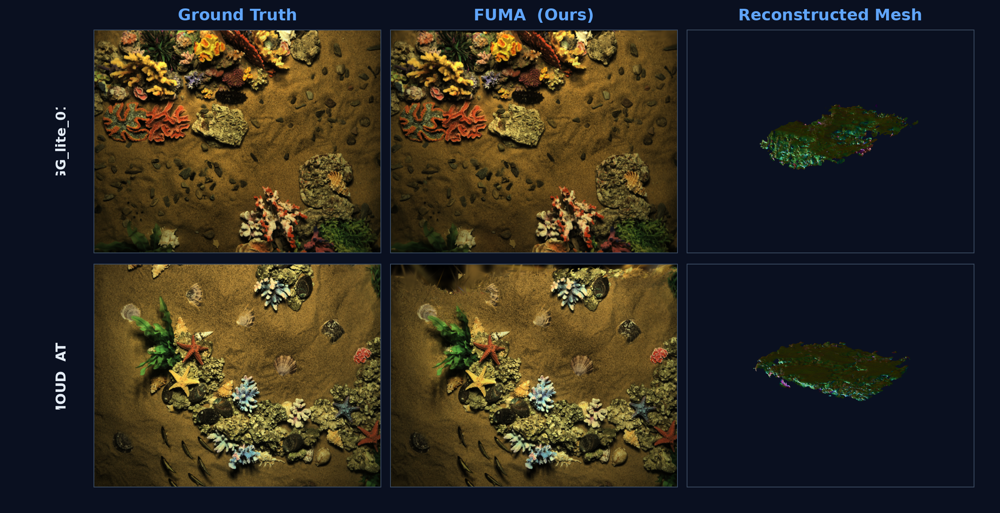
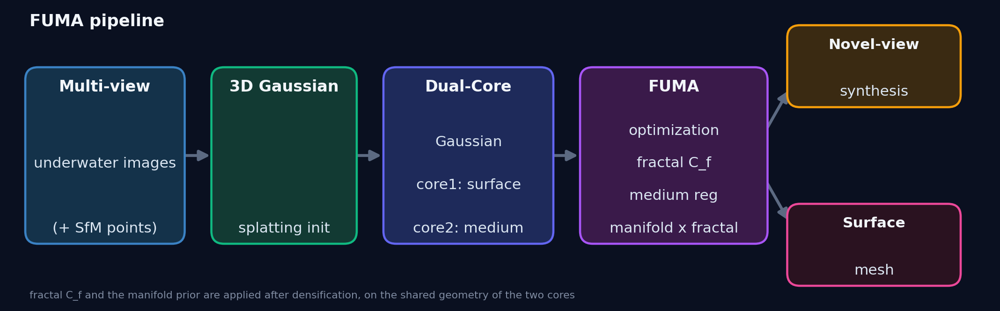

<div align="center">

# **FUMA** 🌊
### **F**ractal-guided **U**nderwater Gaussian **M**odeling
##### *Structure- &amp; medium-aware 3D Gaussian Splatting for underwater novel-view synthesis and surface reconstruction*

[](https://www.python.org/)
[](https://pytorch.org/)
[](https://developer.nvidia.com/cuda-toolkit)
[](LICENSE.md)
[](https://github.com/CXH-9369/FUMA)

</div>

<p align="center">
  
</p>

---

## Abstract

Underwater scenes are hard for 3D reconstruction: light is absorbed and scattered by the medium, the signal is noisy, and surfaces lack the rich texture that reconstruction methods rely on. **FUMA** re-designs [3D Gaussian Splatting](https://repo-sam.inria.fr/fungraph/3d-gaussian-splatting/) into a *structure-aware* and *medium-aware* Gaussian representation that recovers **both** high-quality novel-view synthesis **and** clean surface geometry — without any ground-truth depth or mesh.

Three ideas power the method:

- 🔵 **Dual-Core Gaussians** — every Gaussian carries *two* opacity cores: a **surface core** that drives geometry (and later mesh extraction) and a **medium/scattering core** that absorbs underwater light attenuation and backscatter. A *structure loss* activates the separation; a *medium regularization* couples the two cores in turbid regions.
- 🌀 **Fractal complexity** — a per-view differential-box-counting (DBC) fractal map measures local structural richness. Smooth water is regularized strongly; complex coral and wreck structure keeps its detail.
- 📐 **Manifold × fractal surface prior** — SuGaR-style flatness (minimise the smallest covariance axis) plus 2DGS-style k-NN normal consistency, applied to the surface core and modulated by `α_core1 · (1 − C_f)`. This is what turns the Gaussian field into an extractable surface mesh.

<p align="center">
  
</p>

---

## Highlights

- **One field, two goals.** A single Gaussian model jointly optimizes appearance (novel views) and geometry (surface) — the surface core is the same representation used for rendering and for mesh extraction.
- **Physics-aware.** The medium core and medium regularization explicitly model underwater light transport, improving PSNR by up to **+2.7 dB** over 3DGS on the Panama coral scene.
- **Fractal-modulated regularization.** Regularization strength follows local fractal complexity, so detail is preserved exactly where it matters.
- **Mesh out of the box.** A self-contained Poisson reconstruction extracts an oriented surface mesh from the surface core + manifold-smoothed normals — no GT mesh, no depth supervision.

---

## Results

### Novel-view synthesis &nbsp; *(config `F`, 30k iterations)*

| Scene | Description | PSNR ↑ | SSIM ↑ | LPIPS ↓ |
|:---|:---|---:|---:|---:|
| Panama | coral reef | **26.18** | 0.794 | 0.260 |
| MOUD — AT1 | underwater wreck | **31.56** | 0.937 | 0.138 |
| GG_lite_01 | turbid harbour | **34.77** | 0.963 | 0.093 |

### Ablation on Panama *(30k iterations)*

| Config | Components | PSNR ↑ | SSIM ↑ | LPIPS ↓ |
|:---|:---|---:|---:|---:|
| A | 3DGS baseline | 23.37 | 0.750 | 0.309 |
| B | + Dual-Core | 26.09 | 0.794 | 0.258 |
| C | + Fractal growth | 23.58 | 0.736 | 0.308 |
| D | + Medium regularization | 26.34 | 0.796 | 0.255 |
| E | Full (with fractal growth) | 25.95 | 0.786 | 0.248 |
| G | Dual-Core + Medium + Structure | 26.05 | 0.795 | 0.258 |
| **F** | **G + Manifold × fractal prior (ours)** | **26.18** | **0.794** | **0.260** |

> 💡 Fractal **growth** (configs C/E) doubles the number of Gaussians with *no* NVS gain, so it is dropped from the released method. Fractal **complexity** `C_f` is kept — not for densification, but as the modulator of the manifold prior.

### Geometry (self-supervised, Panama)

| | Normal consistency ↑ | s_min (median) ↓ |
|:---|---:|---:|
| G (no manifold prior) | 0.663 | 3.4e-4 |
| **F (ours)** | **0.841** &nbsp;(**+27%**) | **3.8e-5** |

The manifold prior collapses the surface core into near-flat, normal-consistent discs — which is precisely what Poisson reconstruction needs to return a clean mesh.

---

## Installation

**Tested on:** Python 3.9, PyTorch 2.1.2 + CUDA 11.8, an NVIDIA A6000 (sm_86).

```bash
# 1) environment
conda create -n fuma python=3.9 -y
conda activate fuma
pip install torch==2.1.2 torchvision==0.16.2 --index-url https://download.pytorch.org/whl/cu118

# 2) core dependencies
pip install plyfile tqdm

# 3) build the two CUDA rasterizers (from the repo root)
pip install submodules/diff-gaussian-rasterization submodules/simple-knn

# 4) geometry / visualization extras
pip install open3d trimesh scipy matplotlib plotly pillow
```

---

## Quick start

### 1 · Train

```bash
python train.py -s <path/to/scene> -m <path/to/model> \
    --eval --fuma_ablation F --iterations 30000 --quiet
```

`--fuma_ablation F` selects the full FUMA configuration (Dual-Core + Medium + Structure + Manifold prior). A–G are available; see `arguments/fuma_config.py`.

### 2 · Render test views &amp; metrics

```bash
python render.py  -m <path/to/model> --iteration 30000
python metrics.py -m <path/to/model>
```

### 3 · Extract the surface mesh

```bash
python extract_mesh.py -m <path/to/model> --iteration 30000 \
    --alpha1_threshold 0.05 --depth 9 --density_quantile 0.05 \
    --output <path/to/mesh.ply>
```

The surface is the set of Gaussians whose surface-core opacity `sigmoid(α_core1)` exceeds the threshold; normals are the smallest-scale covariance axes, oriented toward the training-camera centroid.

### 4 · Interactive viewer

```bash
# self-contained HTML (Three.js inlined — opens from file:// or any static server)
python make_viewer.py <path/to/mesh.ply> -o viewer.html

# or a Plotly notebook (native in VSCode / Jupyter)
python make_viewer_nb.py <path/to/mesh.ply> --tag F
```

### 5 · Ablation runner

```bash
python run_ablation.py -s <path/to/scene> -o <output_root> \
    --iterations 30000 --configs A B C D E F G
```

Trains, renders, evaluates, and writes `ablation_summary.json`.

---

## Repository structure

```
gaussian-splatting/
├── train.py / render.py / metrics.py     # core 3DGS loop (FUMA-extended)
├── run_ablation.py                       # A–G ablation runner
├── extract_mesh.py                       # Poisson mesh from the surface core
├── eval_geometry.py                      # self-supervised geometry metrics
├── make_viewer.py / make_viewer_nb.py    # interactive mesh viewers
├── arguments/fuma_config.py              # FUMA configs, losses, hyper-parameters
├── scene/gaussian_model.py               # dual-core Gaussians + losses
├── gaussian_renderer/                    # dual-core alpha blending
└── assets/                               # teaser & pipeline figures
```

---

## Citation

If you use FUMA in your research, please cite this repository and the original 3D Gaussian Splatting work it builds upon.

```bibtex
@misc{fuma2026,
  title        = {{FUMA}: Fractal-guided Underwater Gaussian Modeling},
  author       = {CXH-9369},
  year         = {2026},
  howpublished = {\url{https://github.com/CXH-9369/FUMA}}
}

@Article{kerbl3Dgaussians,
  author  = {Kerbl, Bernhard and Kopanas, Georgios and Leimk{\"u}hler, Thomas and Drettakis, George},
  title   = {3D Gaussian Splatting for Real-Time Radiance Field Rendering},
  journal = {ACM Transactions on Graphics},
  volume  = {42},
  number  = {4},
  year    = {2023}
}
```

---

## License

The code inherits the **Gaussian-Splatting License** (Inria / MPI Informatik) — see [LICENSE.md](LICENSE.md) for the full terms. The FUMA additions are released under the same license.

---

## Acknowledgements

FUMA builds on [3D Gaussian Splatting](https://repo-sam.inria.fr/fungraph/3d-gaussian-splatting/) (Inria / GraphDeco), and draws on ideas from [SuGaR](https://github.com/Anttwo/SuGaR) (flatness prior) and [2DGS](https://surfsplatting.github.io/) (smallest-scale-axis normals).
